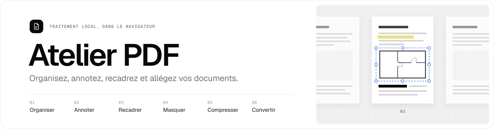

  

# Atelier PDF

Outil de manipulation de PDF en un seul fichier HTML. Aucune installation, aucun compte, aucun serveur : tout le traitement se fait dans le navigateur, aucun fichier ni mot de passe ne transite par le réseau.

Application : https://ninjathune-human.github.io/PDF-FLOW/

## Fonctions

| Fonction | Détail |
|---|---|
| Organiser | Un clic sélectionne une seule page, la pastille ronde cumule la sélection. Réorganisation par glisser-déposer. Suppression depuis la barre de sélection, confirmée puis annulable. Déposer un PDF sur le document ouvert ouvre le choix des pages à ajouter à la suite |
| Ajouter | Pages d'autres PDF ou images (JPEG, PNG, HEIC, WebP), prévisualisées avant insertion : on coche les pages voulues |
| Extraire | Sort la sélection courante dans un fichier séparé, sans altérer le document de travail |
| Déverrouiller | Retire un mot de passe connu ou des restrictions de permissions (qpdf-wasm). S'ouvre d'elle-même sur un PDF protégé |
| Rechercher | Plein texte dans la couche de texte du PDF et dans les mots reconnus par OCR. Sur la grille, les pages trouvées ressortent avec leur nombre d'occurrences, les autres s'estompent ; dans l'éditeur, chaque occurrence est surlignée. Le bouton ✕ ou Échap vide le champ |
| Convertir | **Bêta.** Document Word (.docx) converti en pages PDF vectorielles, texte sélectionnable, puis choix des pages à insérer |
| Recadrer | Rectangle ajustable, détection automatique du contenu, page par page ou par lot, depuis le menu Éditer ou l'éditeur. Dans l'éditeur, avec une image ou une zone copiée sélectionnée, le bouton recadre l'objet seul, à la manière de Photoshop et d'Office, sans perte : l'original reste et peut être rendu |
| Pivoter | ±90°, par page ou par lot, depuis la barre de sélection |
| Supprimer les marges | Détection du contenu, marge conservée réglable, annulation à bascule |
| Annoter | Stylo, surligneur fluo (jaune, vert, magenta, bleu), formes (rectangle, ellipse, flèche, trait), texte avec police, taille, gras et italique, image ou page de PDF (vectorielle, choix de la page si le fichier en compte plusieurs). Un appui sélectionne un objet quel que soit l'outil ; ses poignées le déforment. Vectoriel à l'export |
| Copier une zone | L'icône de l'outil sert de presse-papiers. Vide, le tracé copie la zone, qui file se loger dans l'icône ; pleine, le tracé la pose, sur la même page ou une autre, et l'icône se vide. Vectoriel, sans perte. Une fois posée, elle se déplace, se redimensionne et se recadre comme une image |
| Masque | Blanc par défaut, ou noir. Suppression réellement destructive : la zone est peinte au niveau du pixel avant réencodage |
| OCR | Français, anglais ou les deux. Couche de texte invisible calée sur les mots détectés |
| Compresser | Trois préréglages, rastérisation et réencodage JPEG |
| Exporter | Vectoriel préservé, sauf sur les pages contenant un masque |
| Apparence | Mode clair par défaut, bascule vers le mode nuit, choix mémorisé. Respecte les réglages système de transparence réduite, de contraste renforcé et de mouvement réduit |

Le modèle est non destructif : recadrage, rotation, annotations, masques et OCR sont conservés en état et appliqués uniquement à l'export.

Une page recadrée s'affiche recadrée partout : vignette (rendue plus grande pour rester nette) et éditeur, limité à la zone conservée. Les annotations situées hors de cette zone restent stockées mais ne sont pas visibles dans l'éditeur.

L'orientation du document d'origine est respectée partout, vignettes comme éditeur. Un texte saisi sur une page pivotée s'écrit droit à l'écran et reste solidaire du papier si la page est pivotée ensuite.

## Usage

Ouvrir `atelier-pdf.html` dans un navigateur, ou passer par le lien ci-dessus. Conçu pour PC, iPad et iPhone, avec prise en charge du tactile et du stylet.

**Grille des pages.** La barre d'outils regroupe trois menus, Éditer, Annoter et Convertir, un champ de recherche, puis Compresser et Exporter le PDF. Les rotations, l'extraction et la suppression vivent dans la barre de sélection, au-dessus des vignettes, puisqu'elles portent sur les pages choisies. Au téléphone, les menus s'ouvrent en feuille basse.

**Éditeur.** Double-clic sur une vignette, ou Annoter › Ouvrir l'éditeur. Plein écran, en trois bandes : l'en-tête (pages, mode d'emploi, Annuler, Supprimer, Terminé), une barre de propriétés qui change avec l'outil (couleurs, formes, options de texte, épaisseur, recherche, zoom), puis la table de travail avec sa palette d'outils : sélection, recadrage, stylo, surligneur, forme, texte, image, copie de zone, masque. Chaque outil affiche son nom au survol.

Le bouton ? de l'éditeur, ou la touche ?, ouvre un mode d'emploi interrogeable, tolérant aux fautes de frappe. Le même contenu est dans [`MODE-EMPLOI.md`](MODE-EMPLOI.md).

| Raccourci | Effet |
|---|---|
| ? | Ouvre le mode d'emploi de l'éditeur |
| Double-clic sur une vignette | Ouvre l'éditeur sur cette page |
| Suppr, ou Retour arrière | Grille : supprime les pages sélectionnées. Éditeur : supprime l'objet sélectionné |
| Ctrl ou Cmd + Z | Éditeur : retire le dernier objet posé |
| Échap | Ferme la fenêtre ouverte, vide le champ de recherche, ou annule le recadrage d'un objet |
| Entrée | Valide le texte saisi ou le recadrage d'un objet |
| Appui simple sur un objet, quel que soit l'outil | Sélectionne l'objet ; un glisser trace |
| Appui hors de la page | Revient à l'outil de sélection |
| Glisser une zone vide, page agrandie | Déplace la vue, outil de sélection actif |
| Espace maintenu, bouton central, deux doigts | Déplace la vue |
| Ctrl ou Cmd + molette, pincement | Zoome |
| Maj + molette | Défilement latéral |

## Fichiers

| Fichier | Rôle |
|---|---|
| `atelier-pdf.html` | L'application entière : HTML, CSS et JS en ligne |
| `index.html` | Redirection, pour GitHub Pages |
| `docx-labo.html` | Laboratoire de la conversion Word : mesure la fidélité d'une conversion |
| `MODE-EMPLOI.md` | Mode d'emploi de l'éditeur |
| `CHANGELOG.md` | Historique des versions |
| `CLAUDE.md` | Conventions d'architecture et de design, à lire avant toute modification |

## Dépendances

Chargées par CDN à l'exécution, pas de build :

- [pdf-lib](https://pdf-lib.js.org/) 1.17.1, mutation des pages et dessin vectoriel
- [pdf.js](https://mozilla.github.io/pdf.js/) 3.11.174, rendu des pages en canvas
- [qpdf-wasm](https://github.com/neslinesli93/qpdf-wasm), déverrouillage, chargé à la demande
- [tesseract.js](https://tesseract.projectnaptha.com/) 5, OCR, chargé au premier usage
- [docx-preview](https://github.com/VolodymyrBaydalka/docxjs) 0.4.1 et [JSZip](https://stuk.github.io/jszip/) 3.10.1, lecture et composition des fichiers Word, chargés au premier usage
- [@pdf-lib/fontkit](https://github.com/Hopding/fontkit) 1.1.1, intégration des polices dans le PDF converti
- Polices [Arimo, Tinos et Carlito](https://fontsource.org/), licence OFL, jumelles métriques d'Arial, Times New Roman et Calibri
- Police d'interface [Geist et Geist Mono](https://vercel.com/font), licence OFL, via @fontsource-variable 5.3.0

Une connexion est donc nécessaire au premier chargement. Une version entièrement embarquée hors-ligne est une piste ouverte.

## Limites connues

- Le déverrouillage suppose un mot de passe connu. Aucune tentative par force brute n'est possible ni prévue.
- La compression transforme le texte natif en image : il n'est plus sélectionnable dans le fichier compressé.
- Les images ne peuvent pas encore ouvrir une session vide, un PDF de départ est requis.
- La fenêtre de recadrage de page affiche la page non tournée, contrairement à la grille et à l'éditeur.
- La conversion Word est en bêta. Fidèle sur les documents courants, courrier, compte rendu, CV. Approchée sur les zones de texte, formes, trames à motif et champs calculés. La pagination suit celle de Word lorsque le fichier en garde la trace, c'est-à-dire lorsqu'il a été enregistré en dernier par Word ; sinon elle est recalculée. Pour un rendu exact, exporter en PDF depuis Word ou Pages. `docx-labo.html` mesure la fidélité d'une conversion sur un fichier donné.
- La recherche positionne le surlignage au prorata des caractères : sur une police à chasse variable, il peut déborder d'un caractère. Les textes pivotés à l'intérieur du PDF, cartouches verticaux notamment, sont mal encadrés.
- Les vignettes sont toutes calculées à l'ouverture. Sur un document de plusieurs dizaines de pages, prévoir un temps de chargement.
- Les fonctions qui déclenchent un téléchargement ne fonctionnent pas dans un aperçu en bac à sable : ouvrir le fichier directement dans le navigateur.

## Licence

À définir.
